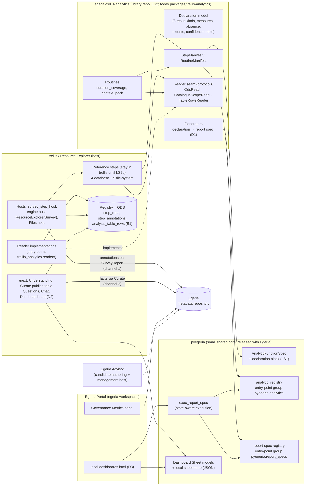
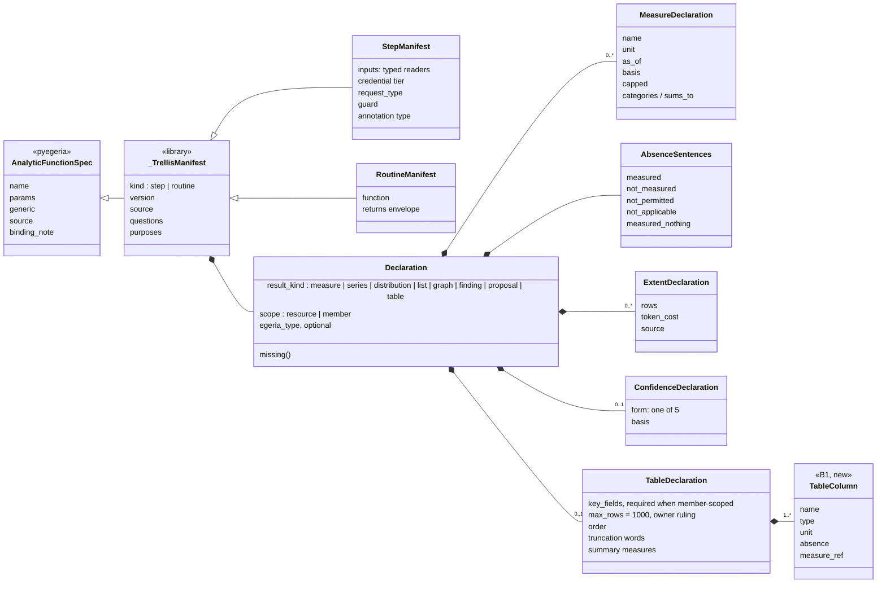
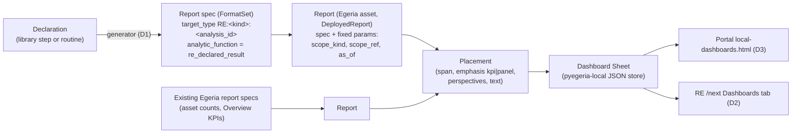
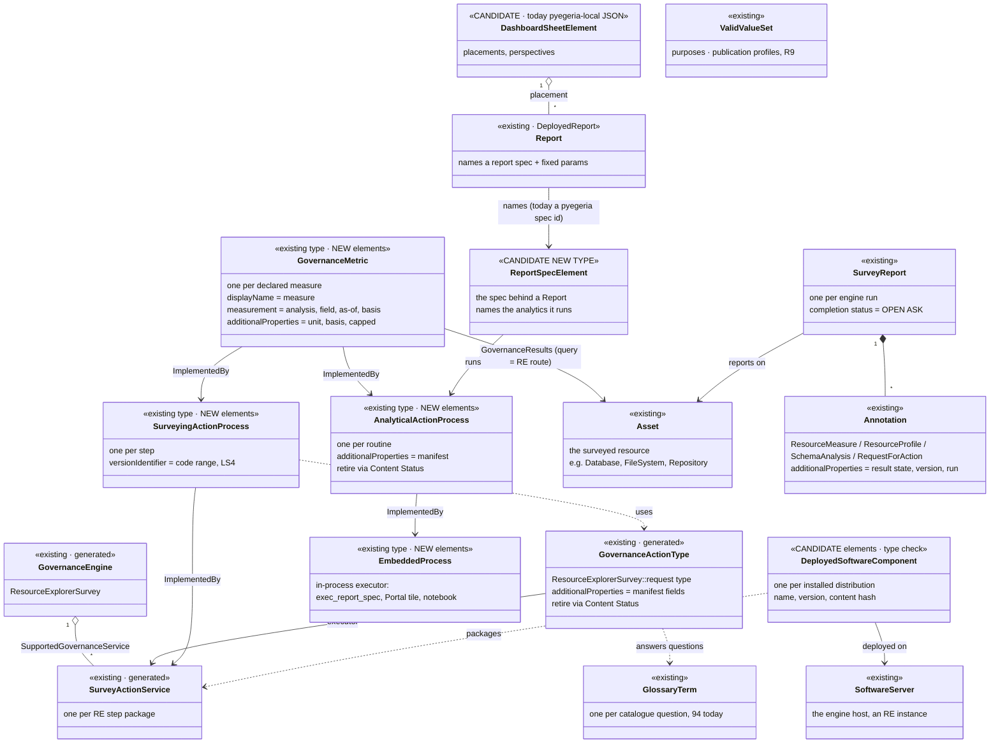

# Trellis extensibility — analytics, local dashboards and their Egeria objects (summary, 2026-11-03)

A one-place summary of the current design for user-extensible analytics in Trellis / Resource Explorer (RE), the
Egeria Portal and Egeria Advisor (EA): what a step or routine is, how it is declared, packaged, discovered, run,
stored, published and shown on a local dashboard, and which Egeria objects carry each fact, including the ones we
may still need.

It summarises, without replacing, these sources (read them for the reasoning and the owner's verbatim rulings):

| Source | Where |
|---|---|
| Working assumptions A1–A11, requirements R1–R20, #603 appendix | [DESIGN-ANALYTIC-EXTENSIBILITY-WORKING-ASSUMPTIONS.md](DESIGN-ANALYTIC-EXTENSIBILITY-WORKING-ASSUMPTIONS.md) |
| Result kinds, rendering, chat, confidence | [DESIGN-DECLARED-EXTENSIBILITY-RENDERING-CHAT-CONFIDENCE.md](DESIGN-DECLARED-EXTENSIBILITY-RENDERING-CHAT-CONFIDENCE.md) |
| Publish table (slice 1 PR2) | [DECLARED-EXTENSIBILITY-SLICE1-PR2-PUBLISH-TABLE.md](DECLARED-EXTENSIBILITY-SLICE1-PR2-PUBLISH-TABLE.md) |
| Local dashboards from declared analytics | [DESIGN-LOCAL-DASHBOARDS-DECLARED-ANALYTICS.md](DESIGN-LOCAL-DASHBOARDS-DECLARED-ANALYTICS.md) |
| Lifecycle, tiers, "what to hold in Egeria" (§8, §14–§16) | [DESIGN-ANALYTIC-LIFECYCLE-2026-10-30.md](DESIGN-ANALYTIC-LIFECYCLE-2026-10-30.md) |
| Library split LS1–LS6, versions, lazy loading | [DESIGN-ANALYTIC-LIBRARY-SPLIT-2026-10-30.md](DESIGN-ANALYTIC-LIBRARY-SPLIT-2026-10-30.md) |
| What is outstanding (Tier A/B/C); B1 member-scoped table result; LS2 library move | the Architect's working notes, not in the repository: `EXTENSIBILITY-OUTSTANDING-2026-11-02`, `DESIGN-B1-MEMBER-SCOPED-TABLE-RESULT-2026-11-02`, `BRIEF-LS2-LIBRARY-MOVE-WITH-PORTAL-2026-11-02` |

---

## 1. The design in five sentences

1. There are two kinds of analytic: a **step** measures a resource during a survey (it needs a credential and an
   executor, and it writes results to RE's store); a **routine** computes over data already collected (it runs wherever
   the library imports: a script, a notebook, a Portal tile or RE, and it returns a result).
2. Each one carries a **declaration**: its result kind, measures with units and as-of, absence sentences, extents,
   confidence and an optional Egeria annotation type. That one declaration drives every surface: Understanding,
   chat, the publish table, the Questions row and the dashboard tile. Nothing on any surface is coded per analysis.
3. Code ships as **Python packages**. Installing a package registers it: steps and routines through the
   `pyegeria.analytics` entry-point group, report specs through `pyegeria.report_specs`. Report specs name functions
   only by registered name; dotted paths are refused from pyegeria 6.2.19.
4. **Results stay local** in RE's registry, which acts as an operational data store (ODS). Every row carries a result
   state; absence is never zero. Results go to Egeria one way, as annotations on a SurveyReport or as facts through
   Curate, and a person chooses which.
5. A **local dashboard** is the Portal's Dashboard Sheet: Dr.Egeria `Create Report` and `Create Dashboard Sheet`
   documents whose Reports name report specs. RE contributes one report spec per declared analysis, generated from the
   declaration, so the same sheet renders in the Portal and in RE with RE's provenance words.

---

## 2. Where the pieces live

**Rule for what moves into the library** (library split §1): it declares its result, reads only through named typed
readers, writes nothing, and needs no RE screen. A step that fails the reader test is a *surveyor* and stays with the
host that owns its table.

**Rule for converting RE's own analyses** (owner, 2026-10-31): an analysis becomes a library step when it is next
touched for another reason, never as a batch. Two conditions apply first: the typed read must say every fact the
native read uses (Tier A's `table_kind` closed this for table scope), and per-member detail must have a declarable
shape (B1's table result closes this).

---

## 3. The library-side model (what a step or routine declares)

**Result states, everywhere.** Each result row is in one of five states: *measured*, *not measured*, *not permitted*,
*not applicable* or *measured nothing*. Each state has a declared sentence. The state is persisted with the row
(working-assumption A4, amended), not derived at read time.

**Result kind → default Egeria annotation type** (rendering note §2):

| Kind | Renders as | Egeria type by default |
|---|---|---|
| measure | stat tile | ResourceMeasureAnnotation |
| series | line chart | ResourceMeasureAnnotation (per point, or the series as one) |
| distribution | bar chart | ResourceProfileAnnotation |
| list | resizable table | SchemaAnalysisAnnotation, or a list on one annotation |
| graph | graph renderer | DataFlow / lineage as facts; ResourceMeasureAnnotation for counts |
| finding | finding row | RequestForActionAnnotation |
| proposal | proposal row + verdict | the proposal's own annotation; a fact only after a verdict |
| table (B1) | collapsed table under the summary | summary measures only (owner: "Summary only"; no rows leave RE) |

The native publish route writes **ResourceMeasureAnnotation only** today. Other declared types are shown as what the
row "writes as", with Publish disabled and the reason given.

---

## 4. Local dashboards

- **Authored** in Dr.Egeria: `Create Report`, `Create Dashboard Sheet`, `Link Report to Dashboard Sheet`,
  `Add Text on Dashboard Sheet`. Git holds the document; the sheet store is a cache of it.
- **Scope** is fixed in the Report, not chosen on the tile. It is one of *resource*, *investigation*, *work list*
  or *all*. An "all" tile counts the resources with no answer in words ("12 of 40 measured; 28 never run").
- **Tile rules:** a tile is the declaration rendered; absence is shown as a sentence; every number carries its as-of
  and basis; a tile is local by default and never publishes; it costs nothing to fetch because it reads stored
  results; reads run as the viewer.
- **Status:** registration through entry points (Q2(b)) and the Curation Coverage tile are live. The generator
  (`re_declared_result`), the RE Dashboards tab and the Portal's provenance fields (D1–D4) are designed but not built.

---

## 5. Egeria objects — what exists, what we generate, what we may need

Rule (owner, 2026-10-07: "follow Egeria's lead"): use an existing Egeria type before a new one, and add a new object
only where no existing type carries the fact without bending it.

### 5.1 Mapping table

| Lifecycle fact | Egeria home | Status |
|---|---|---|
| A step exists and Egeria may dispatch it | `GovernanceEngine` ResourceExplorerSurvey → `SupportedGovernanceService` → `SurveyActionService`; `GovernanceActionType` `ResourceExplorerSurvey::<request type>` | **existing, generated** by `generate_engine_host_declaration.py`; the owner runs it |
| A step's manifest fields (version, inputs, tier, guard, questions, purposes) | `additionalProperties` on the GovernanceActionType | existing carrier |
| A step as a process, so steps and routines read alike | `SurveyingActionProcess` (or `AnalyticalActionProcess` where it derives rather than surveys) —`ImplementedBy`→ the GovernanceActionService | **new elements**, existing types; the generator gains the process element and the link |
| The code version a definition requires | `versionIdentifier` on the step element (a PEP 440 range); the host refuses out-of-range runs with words | ruled (LS4); not built |
| A routine exists | `AnalyticalActionProcess` —`ImplementedBy`→ `EmbeddedProcess` (in-process executor) | **new elements**; first pass, "may change" (owner) |
| A declared measure | `GovernanceMetric` per measure; `ImplementedBy`→ the process element; `GovernanceResults`→ the resource Asset | **new elements**; a new `generate_governance_metrics.py` is needed. No attribute additions for the first pass; unit, basis and capped go in `additionalProperties` |
| A run | `SurveyReport` (engine-dispatched steps); RE `step_runs` otherwise | existing. **Open ask:** a survey-outcome / completion-status convention (#603 decision 9, Java side) |
| Results | annotations on the SurveyReport (channel 1); facts through Curate (channel 2) | existing; publication is one-way |
| Result state, version and run on every annotation | annotation `additionalProperties` | built. **Open ask (R5):** an agreed annotation *envelope* with the Egeria leads, so state stops riding in free-form properties |
| Member-scoped table (B1) | summary measures as ResourceMeasureAnnotation; rows stay in RE | owner: "Summary only" |
| Questions a step answers | glossary terms (94 exist) | existing |
| Purposes; publication profiles (R9) | valid-value sets | existing type; profiles not built |
| Retirement | Content Status DEPRECATED on the GovernanceActionType or the process element | existing |
| Installed distribution (which version is where) | a deployed-component / `SoftwareCapability` element on the engine host's `SoftwareServer` | **candidate**; type check needed; owner: "when a second host exists" |
| Report (a placement's parameters) | `Report` asset (`DeployedReport`) | existing (Portal) |
| The report spec behind a Report | none: specs live in pyegeria and the user JSON directory | **candidate new type or element.** Owner direction: "transition report_specs themselves into a set of Egeria elements". Queued behind the library split |
| Dashboard Sheet | pyegeria-local JSON store, bind-mounted | **candidate**: moving it into Egeria is a pyegeria decision (dashboards note §9.1) |

### 5.2 What we may need from Egeria (the short list)

1. **Report spec as an Egeria element.** This is the only likely genuinely new type. It is the missing link between
   a `Report` and the `AnalyticalActionProcess` it runs. It needs a type check and a design note.
2. **Dashboard Sheet in Egeria.** Today the sheet lives in pyegeria's JSON store. It becomes a natural follow-on once
   report specs are elements; its placements could map onto a collection-style type.
3. **Annotation envelope (R5).** Agree the required fields (result state including *not applicable* versus *not
   established*, the run, the producer version) as a typed part of `Annotation`, rather than `additionalProperties`.
4. **SurveyReport completion status.** One survey-outcome convention for RE and engine surveys.
5. **Typed GovernanceMetric attributes (later).** Unit, basis and capped, if experience shows `additionalProperties`
   is not enough.
6. **Deployed distribution element.** Probably existing types suffice; check before creating any.

Everything else is **new elements of existing types**, generated from declarations and run by the owner:
SurveyingActionProcess and AnalyticalActionProcess, EmbeddedProcess, GovernanceMetric, plus the `ImplementedBy` and
`GovernanceResults` relationships.

---

## 6. Status as of 2026-11-03

| Area | State |
|---|---|
| Declaration model (8 kinds; `capped`, `basis`, `categories`), publish table, graph renderer | built and merged |
| Registration through entry points; registered-name resolver; `PYEGERIA_REPORT_SPEC_MODULES` removed | built (pyegeria 6.2.18/6.2.19; trellis #956/#959; Portal #742/#743) |
| Curation Coverage tile through `pyegeria.report_specs` | live |
| Tier A close-out (`table_kind`, convert-as-touched rule, #603 appendix, floor 6.2.19) | merged (#974); live on 8813 since 2026-11-03 |
| B1 table result + `value_profile` conversion | pushed (`claude/re-b1-table-result`), main merged in; gating; not merged |
| LS2 library move to `egeria-trellis-analytics` (reader seam with 3 protocols; steps stay in trellis until LS2b) | in progress (`claude/re-ls2-seam`; library `ls2/initial-content`) |
| Dashboards D1–D4 (generated report specs, RE Dashboards tab, Portal provenance fields) | designed; not built |
| LS3 lazy loading · LS4 `versionIdentifier` check · LS6 Portal/EA adoption | designed; not built |
| GovernanceMetric / process-element generators | designed; not built |
| Notebook and single-file authoring forms (R1) | ruled; after dashboards D1 |

## 7. Open questions worth putting to the Egeria leads

- Is a new type right for the report spec, or does an existing one (for example, a specialised `Collection` or an
  `InformationSupplyChain`-style element) carry "a declared query plus output formats" without bending it?
- Should `ImplementedBy` from an `AnalyticalActionProcess` point at an `EmbeddedProcess` per host (Portal, RE,
  notebook), or at one element with the host as a property?
- Is `DeployedAnalyticsModel` / `AnalyticsModelRun` worth reserving for model-like routines (scoring, inference)?
- Which annotation-envelope fields can Egeria standardise across all annotation types?
