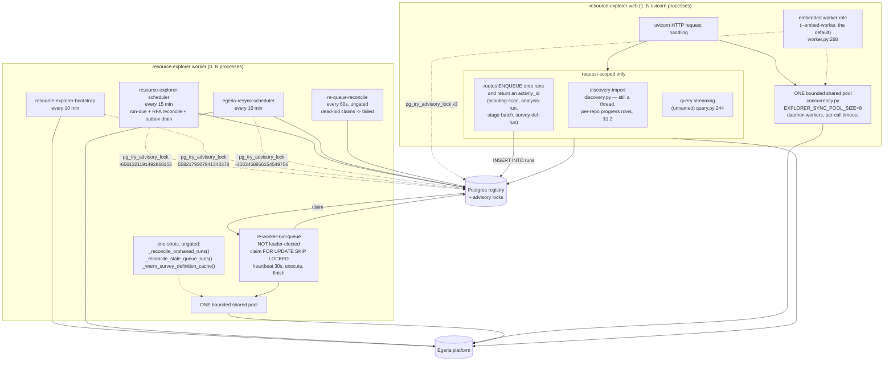
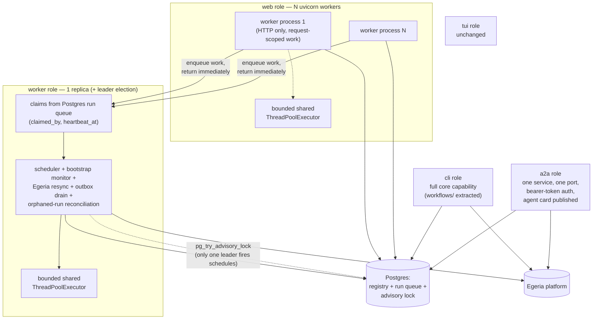

# Resource Explorer — Process & Threading Model

**Status:** live. Process roles, leader locks and loop inventory.

**Added 2026-09-04**, per `docs/runtime-architecture-plan.md` §Sequencing step 1: "Write RE's
threading and process-role model into `docs/Architecture.md`" — this is that write-up, split into
its own file because `Architecture.md` was already dense (see that file's linked pointer). It
preceded, and was a precondition for, the process-role refactor in the plan's step 2. **Rewritten
2026-09-04 after step 2a landed** — Part 1 describes what runs now, not what ran before it. Do not
start step 2b from memory of this document — re-read the current-state sections against the code
first, since this is a snapshot, not a contract the code is held to. Step 2a's own findings F6 and
F7 were both things this document got wrong or did not know until the code was built.

Two parts: **current state** (what runs today, verified against the code, cited file:line) and
**target state** (restated from the plan, not redesigned here). A migration map closes the gap.

---

## Status: step 2a landed, 2026-09-04

This document was written *before* the refactor and described a single process with five
lifespan-started loops and six ad hoc thread pools. **Step 2a of the plan has since landed**, and
Part 1 below has been rewritten to describe what runs now, not what ran then. What moved:

| Moved | From | To |
|---|---|---|
| All three always-on loops, plus both startup one-shots | `web/app.py`'s FastAPI lifespan | `resource_explorer/worker.py`'s `run_worker()`, reached by `resource-explorer worker` or by `web`'s `--embed-worker` |
| "Exactly one process runs each loop" | nothing enforced it (Finding F2) | `pg_try_advisory_lock` per loop, `resource_explorer/leader_election.py` |
| Six ad hoc `ThreadPoolExecutor`s, one of them uncapped | scattered across six call sites | one bounded shared pool, `resource_explorer/concurrency.py` |
| SIGUSR1 thread dump + bounded shutdown | the `web` command only | `_install_stack_dump()`, shared by `web` and `worker` (`cli/main.py:318`) |
| `nest_asyncio` | imported and `apply()`-ed by RE | not imported by RE at all; pyegeria still applies it for its own reasons |

**Step 2b has since landed too (2026-09-04).** The Postgres run queue exists (`runs`,
`run_queue.py`), the four workflows are extracted into `resource_explorer/workflows/`, the routes
enqueue instead of spawning threads, and the CLI has commands on the same functions. §1.2 below
describes the queue rather than the per-request threads it replaced.

**The `a2a` role has since landed too (2026-09-04).** `resource-explorer serve` is now one
service on one port (8090) with every agent routed by path, a bearer token required on every
call, and an agent card per agent plus a `/.well-known/agents.json` index —
`resource_explorer/a2a_role.py`, `a2a_auth.py`, and
[`docs/a2a.md`](a2a.md). All five roles are now real.

**`trellis-auth` adoption has since landed too (2026-09-04, plan §4).** Identity no longer enters
RE through the A2A door and stops there:

- **Login is required** on every non-public path. `trellis_auth.LoginRequiredMiddleware` is
  installed in `web/app.py` under RE's own policy (`resource_explorer/auth.py`,
  `resolve_policy("EXPLORER")`), with `/api/auth/login|portal|me|defaults|policy`, the SPA shell
  and `/.well-known/` public. Middleware order is CORS → login gate → identity → routes, so a
  cross-origin 401 still carries its CORS headers and a rejected request never sets an identity.
- **One identity mechanism.** `a2a_auth.current_caller` — the ContextVar the A2A role already
  had — is now set by the web middleware and by the CLI too. Downstream code asks
  `a2a_auth.caller()` and does not care which door the call came through.
- **Per-request Egeria clients.** `EgeriaPublisher`, `ComponentMaterializer` and
  `BlueprintMaterializer` build their pyegeria clients from the caller's bearer token
  (`egeria_identity.apply_identity`), so Egeria's own provenance records the person. The worker
  role's loops keep the service account, which is the correct attribution for them.
- **`requested_by` is a real user id**, so the per-user fairness rule in §1.2c has stopped being
  inert: `""` now holds only the worker's own service-account runs.
- **Ownership and zones.** Everything RE publishes carries the `Ownership` classification (owner =
  the requesting user). RE imposes no zone on published assets (owner ruling 2026-10-08: DRAFT is
  a content status, not a zone); a draft zone exists only if the deployment sets `EXPLORER_DRAFT_ZONE`,
  and then curate-accept promotes out of it into the configured publish zones. Private-investigation
  work is zoned `[resource-explorer-private, <owner>]`.
- **CLI login.** `resource-explorer login` / `logout`, cached via `trellis_auth.session_file`.
  Commands that reach Egeria exit 2 with one line when the session is missing or expired;
  read-only commands keep working without one.

**Still pending:** a queued run carries `requested_by` but **no token** — see the interim note in
`run_queue._run_as_requester` and `egeria_identity`'s module docstring. The worker publishes as
the service account with `Ownership` set to the requester, which is the attribution curate
authorization reads, but Egeria's provenance for that publish names the worker. Closing it needs
an encrypted-at-rest credential store or a delegation token from Egeria. Also pending: reading
`GovernanceRole` appointments from Egeria instead of the JWT `role` claim.

---

## Part 1 — Current state

Resource Explorer is now **two process roles over one codebase**: `resource-explorer web` (one or
more `uvicorn` processes serving HTTP) and `resource-explorer worker` (every always-on background
loop). `web --embed-worker` — still the default, so `make dev` is one command — runs the worker
role in a daemon thread inside the web process. Which process actually *runs* a given loop is
decided by a Postgres advisory lock, not by which one was started first, so a second RE process
against the same registry stands by instead of duplicating work.

Since step 2b the `web` role also honours its own rule: it spawns no thread for work that
outlives a request. A route that starts a survey writes a row to the Postgres `runs` table and
returns; a `worker` claims and executes it (§1.2).

### 1.1 The background loops and where they live

All of them are started from `run_worker()` in
`packages/resource-explorer/resource_explorer/worker.py:201`. `web/app.py`'s `_lifespan`
(`web/app.py:43`) starts **nothing** of its own; it either spawns the embedded worker or logs that
it did not (`web/app.py:20`, `_embed_worker_enabled`).

```
run_worker(embedded=?, stop_event=...)          # worker.py:201
  _reconcile_orphaned_runs()                    # worker.py:116  one-shot, ungated
  _warm_survey_definition_cache()                # worker.py:134  one-shot, own daemon thread, ungated
  for spec in loop_specs():                      # worker.py:108
      threading.Thread(_supervise, ...)          # worker.py:162  one per loop: win the lock, start it, hold
  stop_event.wait()                              # returns on SIGTERM/SIGINT or lifespan shutdown
  join supervisors within shutdown_timeout       # default 15s, daemon threads so exit never blocks
  concurrency.shutdown(wait=False)               # detach abandoned pool workers — see §1.3
```

| Thread (name) | Source | Loop interval | Advisory key | What it iterates / does | What it writes |
|---|---|---|---|---|---|
| `resource-explorer-scheduler` | `scheduler.py:84` (`start_scheduler`), loop `scheduler.py:132` (`_scheduler_loop`), stopped by `scheduler.py:109` (`stop_scheduler`) | `_CHECK_INTERVAL_SECONDS = 900` (15 min), `scheduler.py:77` | `scheduler` → `-6561321191492868153` | Three things per tick, in order: (1) `_run_due()` (`scheduler.py:286`) — analyses whose `resource_schedules.next_run` has passed, same-repo due surveys coalesced into one orchestrator call to avoid double-downloading a zipball; (2) `_reconcile_rfa_actions()` (`scheduler.py:158`, docs/rfa-egeria-todo-followup.md); (3) `_drain_egeria_outbox()` (`scheduler.py:170`, docs/outbox-publishing-design.md §5) — **this is where the outbox drain lives**; still not a separate loop (Finding F1) | `resource_schedules.next_run`/`last_run_status`, an `ActivityEntry` per run, `rfa_actions` rows, outbox rows via `drain_outbox`, plus `registry.purge_outbox_completed()` retention |
| `resource-explorer-bootstrap` | `bootstrap.py:520` (`start_scheduler`), loop `bootstrap.py:509` (`_loop`) | `CHECK_INTERVAL_SECONDS = 600` (10 min), `bootstrap.py:120`; first pass runs immediately, inside the thread | `bootstrap-monitor` → `5582179307941343378` | `check_and_heal(docs_dir)` — detects and repairs Dr.Egeria definitions (glossaries, perspectives, Question terms, Survey Definitions) wiped by an Egeria reset | Recreates missing Dr.Egeria elements in Egeria; no local table write in the loop itself |
| `egeria-resync-scheduler` | `egeria_resync.py:1254` (`start_scheduler`), loop `egeria_resync.py:1224` (`_loop`) | `CHECK_INTERVAL_SECONDS = 600` (10 min), `egeria_resync.py:1166` | `egeria-resync` → `-3163458856154549756` | `scan_and_clear()` (`egeria_resync.py:1185`) — clears stale Egeria pointers left by a repository-store wipe, applying only `SAFE_SCHEDULED_STEPS` whose findings are present, re-checking `needs_decision`/`EXPENSIVE_STEPS` as defense in depth | In-process `_status` dict read by the admin banner, plus whatever `resync.apply()` clears |
| `re-engine-host` (only with `RE_ENGINE_HOST_ENABLED` on; off by default) | `engine_host.py` (`start_engine_host`, `EngineHostLoop`) | `SWEEP_INTERVAL_SECONDS = 5`, the native engine host's own sweep interval | `engine-host` → `54773764437381287` | `EngineHost.restart_pass()` once at start (queues RE's claimed actions with no run; completes from the stored outcome those whose run ended unrecorded), then `EngineHost.sweep_once()`: lists active engine actions, keeps RE's engine's APPROVED, unclaimed, known-request-type ones with no privately owned target, claims each in Egeria as `Daemon(ENGINE_HOST, requested_by=requesterUserId)` | One `runs` row of kind `engine_action` per claim, run by the queue (`run_queue._handle_engine_action`, as the same daemon): IN_PROGRESS, the step, a SurveyReport, then completion |
| `survey-cache-warm` | `worker.py:134` (`_warm_survey_definition_cache`) | one-shot, not a loop | **none — deliberately ungated** | `SurveyDefinitionReader().warm_question_guid_cache()`; failures swallowed (best-effort) | Module-level `_question_guid_cache` / `_candidates_cache` dicts in `survey_definition_reader.py`, which die with the process |

**Why the two one-shots take no lock**, which is easy to "fix" wrongly in both directions:

- `_reconcile_orphaned_runs()` (`worker.py:116`, calling `run_reconciler.reconcile()`) judges
  ownership **per row** — pid liveness plus a matched process start time — so it is already safe
  in every process, and electing a single leader for it would make it *less* useful, not safer.
- `_warm_survey_definition_cache()` (`worker.py:134`) fills a **process-local** dict. A leader
  would warm one process's cache and leave every other one cold, which is the opposite of the
  point.

**Fixed in passing (a real bug, not a refactor artifact):** the old
`_warm_survey_definition_cache()` in `app.py` was decorated `@asynccontextmanager` while being a
plain synchronous function. Calling it therefore constructed a context-manager object and **never
executed the body**, so the cache warm had silently not happened since that decorator was added —
every restart charged the first user of each phase for its cold lookups, which is precisely the
symptom the warm was written to remove. It runs now: verified live 2026-09-04, "survey-definition
cache warmed: 51 question(s) checked, 48 resolved, 10 definition(s) prefetched, 0 failed".
The failure was invisible from the outside because the warm is best-effort by design — nothing
downstream distinguishes "warmed and found nothing" from "never ran".

### 1.1a Leader election

`resource_explorer/leader_election.py`. One `LeaderLock` per loop (`leader_election.py:77`),
each holding **its own** connection (`NullPool`) for the life of the process, because
`pg_try_advisory_lock` is session-scoped: the lock lives as long as the connection does, and
Postgres drops it automatically when that connection goes — a killed worker frees its locks with
no janitor. The connection is set autocommit (`leader_election.py:106`, `acquire`) so it does not
sit `idle in transaction` for hours blocking vacuum on the shared instance; that was observed
live before the fix.

Keys are **derived, not chosen**: `blake2b(f"{KEY_NAMESPACE}:{name}", digest_size=8)` read as a
signed big-endian int64 (`leader_election.py:69`, `advisory_key`), with
`KEY_NAMESPACE = "resource-explorer/worker"`. The three values are in the table above and are
pinned by `tests/test_process_roles.py::TestAdvisoryKeys::test_keys_are_stable` — a namespace
change would otherwise let an old and a new process each become leader of their own key across a
rolling restart and both run every loop, which presents as duplicated work rather than as an
error. `python -m resource_explorer.leader_election` prints them.

A loop that loses logs `worker loop standby: name=… leader=false advisory_key=…` and retries at
its own interval, so leadership transfers on its own when the holder exits. A loop that wins logs
`worker loop started: name=… interval=…s leader=true advisory_key=… embedded=…`. Those two lines
are the only way to tell from the outside which process owns what — `make ps` cannot, because an
embedded worker looks exactly like a plain web process.

**Non-Postgres registries:** the registry is Postgres-only now (plan §3 retires the SQLite
fallback). A `LeaderLock` built against a `sqlite://` URL logs a warning and **grants**
leadership (`leader_election.py:113`) rather than crashing — a single-process SQLite setup has no
peer to lose an election to. No SQLite locking is implemented or intended.

### 1.2 The run queue — what replaced the ad hoc per-request threads

Until step 2b, a `POST` that started a survey spawned a `daemon=True`
`threading.Thread` and returned `{"status": "started", "activity_id": ...}` while the thread did
the work. Five routes did this: the scouting scan, the single-analysis run, the stage batch, the
Survey Definition run, and the GitHub org import.

**None of them do any more, except the org import** (see below). A route now writes a row to the
Postgres `runs` table and returns; a `worker` process claims it and executes it. Three things that
were true of the thread version and are no longer:

- the run lived in whichever uvicorn process happened to serve the request, so `--workers N`
  spread long-running work across processes by luck of routing;
- a `--no-embed-worker` web process — nominally "HTTP only" — was still where every survey
  actually executed, which is the plan's own rule for the `web` role being broken by the `web`
  role;
- the only record of ownership was a pid buried in an `activity_log` row's `detail`, judged
  *after the fact*. A claim taken before the work starts is the same question asked in time to be
  useful.

**What did NOT change, and must not:** the frontend contract. The route still creates the
`activity_log` row up front, still returns its `activity_id`, and the browser still polls
`GET /api/activity/{id}` and reads the run's result out of that entry's `detail`
(`index.html`'s `_pollActivityUntilDone`). The queue row carries that activity id in `result_ref`,
and the worker writes the terminal activity status through the very same `execute_and_record_*`
functions the route's thread used to call. From the UI's point of view the only difference is
which process did the work. A `run_id` is returned alongside for anyone who wants the queue's own
view; nothing in the frontend reads it.

| Route / trigger | Queue kind | Target | What executes it |
|---|---|---|---|
| `POST /api/projects/{slug}/scouting-scan` | `scouting_scan` | `{slug}` | `workflows.scouting.execute_and_record_scouting_scan` |
| `POST /api/projects/{slug}/analyses/{id}/run` | `analysis_run` | `{slug, analysis_id}` | `workflows.analysis.execute_and_record_analysis` |
| `POST /api/projects/{slug}/analyses/stage/{stage}/run` | `stage_batch` | `{slug, stage, step_keys}` | `workflows.analysis.execute_and_record_stage_batch` |
| `POST /api/survey-definitions/{type}/{slug}/run` | `survey_definition_run` | `{entity_type, slug, params}` | `workflows.survey_definition.execute_and_record_definition` |
| CLI `discovery expand-org --queue` | `discovery_expand` | `{org}` | `workflows.discovery.expand_org` |

**Two threads that deliberately stayed threads.**

- `query.py:244`'s streaming bridge. It has no independent existence past the HTTP response — it
  is request-handling machinery, not backgrounded work, and the `web` role's rule is about work
  that *outlives* the request.
- `discovery.py`'s org import (`_run_import_batch`). It was never held `running` as one row: it
  writes a `scout` activity entry per repo as each completes, so there is no single row for the
  queue's ownership model to own and nothing for the reconciler to resolve. Queueing it would
  have meant redesigning its progress reporting, which is a different change from this one.

### 1.2a The `runs` table

```sql
CREATE TABLE runs (
    id            TEXT PRIMARY KEY,   -- uuid4
    kind          TEXT NOT NULL,      -- analysis_run | survey_definition_run |
                                      --   scouting_scan | stage_batch | discovery_expand
    target        TEXT NOT NULL DEFAULT '{}',  -- JSON; the handler's arguments
    requested_by  TEXT NOT NULL DEFAULT '',    -- user id; "" until trellis-auth
    state         TEXT NOT NULL DEFAULT 'queued',
    claimed_by    TEXT NOT NULL DEFAULT '',    -- "hostname:pid", human-readable
    runner        TEXT NOT NULL DEFAULT '',    -- JSON process_identity(): pid + start time
    enqueued_at   TEXT NOT NULL,
    claimed_at    TEXT NOT NULL DEFAULT '',
    heartbeat_at  TEXT NOT NULL DEFAULT '',
    started_at    TEXT NOT NULL DEFAULT '',
    finished_at   TEXT NOT NULL DEFAULT '',
    error         TEXT NOT NULL DEFAULT '',
    result_ref    TEXT NOT NULL DEFAULT ''     -- the activity_log id the UI polls
);
CREATE INDEX idx_runs_state_enqueued     ON runs(state, enqueued_at);
CREATE INDEX idx_runs_requested_by_state ON runs(requested_by, state);
CREATE INDEX idx_runs_result_ref         ON runs(result_ref);
```

Written by `registry.py`'s `_init_schema` alongside every other table — RE has no separate
migration tool, and `CREATE TABLE IF NOT EXISTS` plus the "add column if missing" pass is the
convention every table here follows.

**A new table, not more columns on `activity_log`.** `activity_log` is the user-facing narrative
of everything that has happened — catalog writes, RFAs, scout entries — and only a minority of its
rows are queueable work. Hanging `state`/`claimed_by`/`heartbeat_at` off all of them would put
queue semantics on rows that can never be claimed, and make "what is queued" a filtered scan of
the largest table in the schema. The two join on `result_ref`.

**`claimed_by` and `runner` are both there on purpose.** `claimed_by` is what an operator reads
(`runs list`, the worker's own log line). `runner` is what reconciliation tests, because a pid
alone is not an identity — pids are reused, which is precisely the trap `run_reconciler._is_alive`
documents.

### 1.2b State machine

```
                    ┌──────────── registry.cancel_queued_run ──► cancelled
                    │
 enqueue ──► queued ─┴─ claim_next_run ──► claimed ──► mark_run_running ──► running
                       (FOR UPDATE                                            │
                        SKIP LOCKED)                                          │
                                                              finish_run ─────┤
                                                                              ├──► succeeded
                                                                              └──► failed
                                          reconcile_runs (dead pid) ──────────────► failed
```

- **`claimed` and `running` are separate.** A claim is taken in one transaction and the work
  starts after it, so a row stuck in `claimed` says "a worker took this and died before it began",
  which is a different fact from "it died mid-run".
- **A claimed or running row cannot be cancelled.** It owns a real Python thread in some worker
  process and Python threads cannot be interrupted. `cancel_queued_run` returns False and the API
  answers 409; writing `cancelled` over live work would be a false claim of exactly the kind
  `run_reconciler.py` exists to remove.
- **`heartbeat_at`** is refreshed every 30 s (`HEARTBEAT_INTERVAL_SECONDS`) by a companion daemon
  thread, not by the executing thread — the executing thread is inside a survey that may not
  return for sixteen minutes, so it cannot also be the thing that proves it is alive. The
  companion thread's liveness is the process's liveness, which is what reconciliation tests.
- **Reconciliation is pid-based, as it has always been.** A heartbeat older than three intervals
  makes a row a *candidate*; only `run_reconciler._is_alive()` returning a definite `False` makes
  it a failure. A worker parked in a slow Egeria call is late, not gone. At worker startup the
  heartbeat filter is skipped entirely (`ignore_heartbeat=True`): a pid that is provably gone is
  gone whether or not it beat ten seconds before it died, and the filter exists only to keep the
  periodic sweep cheap.

### 1.2c Per-user fairness — the plan's step-5 hook

`claim_next_run` will not take a row for a `requested_by` that already has a `claimed` or
`running` row; that user's next row waits. **Scoped to a non-empty `requested_by`, deliberately.**

**Live since 2026-09-04.** Before `trellis-auth` landed, every row was attributed to `""`, the
exemption covered the entire queue, and the rule was inert — applying it to that bucket would have
collapsed the queue to one run at a time for everybody, a visible regression against the pre-queue
behaviour where each route spawned its own thread. `run_queue.requested_by()` now reads the
signed-in caller from RE's identity ContextVar, so the rule applies to real people and `""` is left
holding what it should: **the worker's own service-account runs**. No code changed in
`claim_next_run` when real ids appeared, which is what the hook was for.

A run is also *executed* as the person who queued it: `_run_as_requester` publishes `requested_by`
as the caller for the duration of the handler, so anything the run writes to Egeria is owned by
them. The row carries no token — see that function for the reasoning and for the gap that leaves.

`resource-explorer runs enqueue <kind> <target>` attributes to the signed-in user by default;
`--requested-by alice` still wins, for a script attributing on someone's behalf.

### 1.2d Who runs the queue, and why it is not leader-elected

`run_worker()` starts `run_queue.start_queue_runner()` — a plain thread, **not** a `LoopSpec`, and
the one worker-owned loop that takes no advisory lock. The three background loops take one because
two processes firing the same schedule is duplicated work. The queue is the opposite: `SKIP
LOCKED` means every extra consumer is extra throughput, and electing a leader would make the queue
exactly as fast as its leader. `tests/test_run_queue.py` pins that it is absent from
`loop_specs()`, because "it doesn't take a lock" reads like an oversight.

Each claimed run is executed through the shared bounded pool (§1.3) rather than a thread of its
own — a run is exactly the kind of blocking sync-pyegeria work that pool exists to bound, and a
queue spawning an unbounded thread per row would reintroduce what step 2a removed.

`EXPLORER_RUN_QUEUE_ENABLED=false` stops a process claiming rows without stopping it enqueueing
them or running its background loops — for a deliberate drain pause, and to keep the test suite
from claiming rows out of the shared registry (`tests/conftest.py` sets it).

**The embedded worker executes queued rows too**, so `make dev` is unchanged from a user's point
of view: `web --embed-worker` is still the default, and the worker role it embeds includes the
queue loop. A `--no-embed-worker` web process with no worker running accepts every enqueue and
executes none — visible as `GET /api/runs?state=queued`, which is what makes "nothing is draining
the queue" distinguishable from "this survey is slow".

### 1.3 Sync/async bridging — one bounded shared pool

**Was:** six ad hoc `ThreadPoolExecutor`s, five of them constructed per call, one
(`prefect_adapter.py`) with **no `max_workers` at all**, and one pair in
`survey_definition_reader.py` that nested — a pool of up to 8 workers each opening its own
one-worker pool. **Now:** one pool per process, `resource_explorer/concurrency.py`, sized by
`EXPLORER_SYNC_POOL_SIZE` (default 8, which is what `_GUID_RESOLVE_WORKERS` was).

| Site | Then | Now |
|---|---|---|
| `agents/base.py:199` (`_run_agent`) | `ThreadPoolExecutor(max_workers=1)` per call | `run_sync(lambda: asyncio.run(_inner()))` |
| `agents/conversation_agent.py:144` (`_inject`, memory replay) | same, `.result(timeout=10)` | `run_sync(..., timeout=10)` |
| `agents/conversation_agent.py:272` (`_run_persistent`) | same, no timeout | `run_sync(...)` |
| `tui/app.py:292` (`_add_to_memory`) | same, `.result(timeout=5)` | `run_sync(..., timeout=5)` |
| `surveyors/prefect_adapter.py:179` (`run_prefect_step`'s API branch) | `ThreadPoolExecutor()` — **uncapped** | `run_sync(...)` |
| `surveyors/survey_definition_reader.py:475` (`_lookup_question_guid`, split out of `resolve_question_guid`) | one-worker pool per call, abandoned via `shutdown(wait=False)` on timeout | `run_sync(_call, timeout=_QUESTION_GUID_CALL_TIMEOUT_SECONDS)` — the 15s bound kept (`survey_definition_reader.py:68`) |
| `surveyors/survey_definition_reader.py:663` (`_resolve_question_guids`) | `pool.map(self.resolve_question_guid, rest)` — pooled work that opened its own pool | `submit_all(self._resolve_one_pooled, rest)` (`survey_definition_reader.py:732`) — **leaf** work, plus an overall batch deadline (`survey_definition_reader.py:712`) since the shared pool's width is not `len(rest)` |

**The re-entrancy rule the shared pool needs and the throwaway pools did not.** A bounded shared
pool can self-deadlock: a task that submits back into the pool waits on a slot only a task behind
it could free. Two things prevent it — batch callers submit leaf work (the `_resolve_one_pooled`
split above), and `run_sync` detects that it is already running on a pool thread and runs the
callable **inline** instead of submitting (`concurrency.py:264`). Inline execution loses the
per-call timeout, because there is no second thread to abandon; the caller's own wait is what
bounds it. That is the honest trade — an unbounded wait in one already-owned slot beats a
deadlock that stops every slot.

**Abandoned workers cost more than they used to, and that is the point.** On timeout the worker
is abandoned rather than joined (Python threads cannot be force-killed, and joining one blocked in
Egeria's client is exactly the hang being avoided). The old throwaway pool went with it; a slot in
a *shared* pool does not. `concurrency.stuck_worker_count()` reports how many, so a shrinking pool
is observable rather than inferred from things getting slow.

**Shutdown: `wait=False` was a lie, and this is new information.** Found live 2026-09-04 while
verifying the worker role, using the SIGUSR1 dump §1.4 describes: the worker logged "worker role
stopped cleanly", released its advisory locks — and did not exit. The dump showed the main thread
parked in `concurrent.futures.thread._python_exit -> join` behind two pool workers in the exact
`get_guid_for_name -> nest_asyncio -> select()` frame from the incident.

`_python_exit` joins every pool worker regardless of `shutdown(wait=False)`, and CPython's
`_thread_shutdown()` then waits for them because pool workers are not daemon threads. **The old
per-call pools had precisely the same exposure** — `shutdown(wait=False)` never detached anything
— so this is plausibly part of why the original incident needed a `kill -9` after SIGTERM was
ignored for 8+ seconds. Two fixes, both in `concurrency.py`:

- `_spawn_daemon_workers()` (`concurrency.py:185`) creates all the workers up front from a daemon
  thread, because `threading.Thread` inherits `daemon` from its creator and there is no supported
  way to daemonise a thread afterwards. Daemon workers are not waited for.
- `detach_workers()` (`concurrency.py:298`) removes them from
  `concurrent.futures.thread._threads_queues`, which is what `_python_exit` iterates. Private
  name, guarded call: a CPython rename costs the fast exit, not an exception.

Both roles call `concurrency.shutdown(wait=False)` explicitly on the way out (`worker.py`'s
`run_worker` finally block, and `cli/main.py:473` after `uvicorn.run` returns) rather than relying
on `atexit`, which runs *after* the interpreter has already joined those threads.

**The cross-loop hazard itself is still not fixed.** Collapsing the pools does not resolve it —
`get_guid_for_name` still reaches `nest_asyncio.run_until_complete` inside *pyegeria*, and the
worker's own SIGUSR1 dump caught two threads in that frame again on 2026-09-04. What is true is
that RE no longer imports or applies `nest_asyncio` itself (see below), every bridge is now a
fresh `asyncio.run()` in a pool thread, and the per-call bound plus real abandonment mean a hang
degrades to "not found" and cannot hold the process open. The plan's pyegeria concurrency spike is
still the open item.

**`nest_asyncio` is gone from RE.** `surveyors/prefect_adapter.py` was the only module that
imported it, with a module-level `nest_asyncio.apply()` described as enabling nested loops under
Uvicorn. It was removed on both counts: nothing in RE needs loop re-entrancy any more, and it was
redundant anyway — pyegeria declares `nest-asyncio` as its own dependency and applies it at
package import (`pyegeria/view/mermaid_utilities.py:20`, reached from `pyegeria/__init__.py`), so
the global patch is in effect for any process that touches pyegeria whether RE asks for it or not.
The direct dependency is off RE's `pyproject.toml`; the package stays installed transitively.
`tests/test_process_roles.py::TestNestAsyncio` pins all three facts.

### 1.4 SIGUSR1 thread-dump and bounded shutdown

Added the same day as the incident, in the `web` command only. It is now shared by both roles via
`_install_stack_dump(label)` (`cli/main.py:318`), called from `web` (`cli/main.py:396`) and from
`worker` (`cli/main.py:352`). Still **not** applied when the app is launched by other means (e.g.
`uvicorn resource_explorer.web.app:app` directly, bypassing the CLI).

- **On-demand thread dump**: `faulthandler.enable()` plus, where `SIGUSR1` exists,
  `faulthandler.register(signal.SIGUSR1, all_threads=True, chain=False)`. `kill -USR1 <pid>`
  writes every thread's Python stack to stderr. Deliberately on-demand rather than
  `dump_traceback_later()`'s continuous polling, so it costs nothing while idle. **This earned its
  keep during this very refactor** — it is what identified `_python_exit`'s join as the reason a
  cleanly-stopped worker would not exit (§1.3), a cause no amount of reading the shutdown code
  would have suggested.
- **Bounded graceful shutdown**, per role:
  - `web`: `uvicorn.run(..., timeout_graceful_shutdown=10)` (`cli/main.py:470`).
  - `worker`: SIGTERM/SIGINT set the stop event (`cli/main.py:377`); `run_worker` joins its
    supervisors within `shutdown_timeout` (default 15s, `worker.py:201`), logs anything still
    running, and returns — the supervisors are daemon threads, so a stuck one goes with the
    process instead of holding it open.
  - both: `concurrency.shutdown(wait=False)` on the way out, without which a stuck pool worker
    outlasts every bound above (§1.3).

`_reconcile_orphaned_runs()` (now `worker.py:116`) is what makes a `kill -9` survivable for
survey/analysis runs specifically: process death leaves `activity_log` rows `status="running"`
with an owner recorded, and the next worker start resolves them to `interrupted` rather than
leaving them stuck for ever (`run_reconciler.py`).

### 1.5 Prefect: enabled/unreachable handling and the ephemeral-server leak

`surveyors/prefect_adapter.py`'s `run_prefect_step` checks `config.prefect.enabled`
(`PrefectConfig.enabled`, `config.py:248`) before attempting the Prefect API branch at all; on any
exception other than `PrefectFlowRunCancelled` (an unreachable server, a real bug, anything) it
falls back to running the step locally in-process (`prefect_adapter.py:191-200`) — that fallback
path is not the leak.

**The leak** (found live 2026-09-04, per both `config.py:228-240` and `prefect_adapter.py:6-28`'s
comments): with `config.prefect.enabled=True` and no reachable `PREFECT_API_URL`, Prefect's own
client (`prefect.client.get_client()`) starts an **ephemeral subprocess server** rather than
raising, because Prefect's shipped default profile (`profiles.toml`, `active = "ephemeral"`) sets
`PREFECT_SERVER_EPHEMERAL_ENABLED=true` unless an operator's own profile overrides it, and nothing
in RE ever shuts that subprocess down. Thirteen orphaned
`prefect.server.api.server:create_app` uvicorns, some four days old, reparented to `launchd`, were
found this way.

**As read in the code right now, both parts of the fix described in the plan are already present**
(this contradicts this task's briefing, which said the fix was in progress by another agent
concurrently — either it landed during this session or the briefing was already stale; treat the
following as what the code shows, not as a prediction):

- `config.py:248` — `PrefectConfig.enabled` now defaults to `False` (`PREFECT_ENABLED`), with a
  comment dated 2026-09-04 recording that it was `True` from 2026-08-26 to 2026-09-04 and that the
  `True` default is what leaked.
- `prefect_adapter.py:33` — `os.environ.setdefault("PREFECT_SERVER_EPHEMERAL_ENABLED", "false")`,
  set **before** `import prefect` (Prefect reads settings at import time), as a second, independent
  guard against the same leak regardless of `PrefectConfig.enabled`'s default. `setdefault` so an
  operator who deliberately wants ephemeral-server behavior can still override it via their own
  environment.

`resource_explorer/__init__.py` carries the same `setdefault` at **package import**, which is what
makes it hold in every uvicorn child process under `--workers N` — a CLI-only guard would not.
`tests/test_process_roles.py::TestWebLifespan::test_package_import_still_guards_ephemeral_prefect`
pins that.

(The earlier note here about `CLAUDE.md` calling Prefect "default-on as of 2026-08-26" no longer
applies — that file now says off by default.)

### 1.6 Diagram — current process



Exactly one process wins each key. The embedded worker and a standalone worker compete on equal
terms; whoever loses logs `standby` and retries at that loop's interval.

---

## Part 2 — Target state

Restated from `docs/runtime-architecture-plan.md` §2 (Process roles) and §1 (interaction with
threading/multi-user). Not redesigned here — see the plan for rationale and rejected
alternatives. **Most of this is now the present, not the target.** Four of the five roles are
real: `web` and `worker` were built in 2a, `cli`/`tui` were already real, and 2b gave the CLI the
core capability §3 said it lacked. `web` honours its "never spawns a thread for work that outlives
the request" rule now that the run queue exists. **`a2a` landed on 2026-09-04.** What is still
outstanding is RE-wide `trellis-auth` adoption. The migration map below says which is which.

**Five process roles, one core, one image: `web`, `worker`, `cli`, `tui`, `a2a`.**

- **`web`** — N `uvicorn` workers. Serves HTTP requests only; never spawns a thread for work that
  outlives the request (the `query.py`-style streaming bridge inside one request/response cycle
  is fine; a backgrounded survey run is not). `--embed-worker` runs the `worker` role in-process,
  for the dev profile's single-command `make dev`.
- **`worker`** — owns every background loop (scheduler, bootstrap monitor, Egeria resync, outbox
  drain, orphaned-run reconciliation) plus long-running survey/analysis runs, pulled from a
  Postgres-backed run queue (the `runs` table, §1.2a — a generalization of what
  `run_reconciler.py`'s pid-based ownership check already approximated, but as a claim taken
  *before* the work starts rather than judged after the fact). **Built in 2b.** One compose
  replica in the demo profile — though unlike the loops, more than one replica is *useful* here,
  since `SKIP LOCKED` makes each extra consumer extra throughput. `pg_try_advisory_lock` leader election is cheap insurance so two workers (or a worker
  plus a `--embed-worker` web process) cannot both fire the same schedule.
- **`cli`** — the existing Typer CLI, **now at full core capability** (2b): the three web-only
  workflows plan §3 named — analysis-run-and-auto-publish, GitHub discovery, curate
  materialization — are extracted into `resource_explorer/workflows/` and exposed as commands
  (`analysis run`, `analysis stage-batch`, `scout run`, `discovery search`, `discovery
  expand-org`, `curate materialize`), alongside `runs list|show|cancel|enqueue` for driving the
  queue from a shell. Each runs its workflow inline by default; `--queue` hands it to a worker.
  "Reduced capability" for the CLI now means only: no background loops unless a `worker` is
  running, and no browser-shaped features.
- **`tui`** — the existing Textual app, unchanged.
- **`a2a`** — the entry point for other systems. **Built 2026-09-04.**
  `resource-explorer serve --port 8090` is one service on one port: all seven agents mounted at
  `/agents/<name>`, the orchestrator also at `/`, a bearer token required on every agent call
  (either a trellis app JWT or a raw Egeria bearer token, validated once per token and cached for
  its lifetime — plan §4), an A2A agent card per agent at the SDK's well-known path, and a
  `/.well-known/agents.json` index so a Portal or external orchestrator can discover all seven in
  one fetch. `A2A_ALLOW_ANONYMOUS=true` restores the old no-auth behaviour for local dev and warns
  at startup. `resource_explorer/a2a_role.py` + `a2a_auth.py`; see [`docs/a2a.md`](a2a.md).
  The agentstack SDK hosts exactly one agent per `Server` (design rule 8, re-confirmed against
  agentstack-sdk 0.7.1), so the role mounts each agent's `create_app()` FastAPI application under
  a path prefix on one root instead.

**Process-management rules that come with the roles** (plan §2): no library starts a server on its
own (`PREFECT_ENABLED` defaults `False`, `PREFECT_SERVER_EPHEMERAL_ENABLED=false` set in every
profile — already true in the code today, see §1.5 above); every long-running unit of work has a
row recording who owns it, when it last heartbeated, how to kill it; every process answers
`SIGUSR1` with a thread dump and shuts down within a bound (**done for `web`, `worker` and
`a2a`**, `cli/main.py`'s `_install_stack_dump`; `cli`/`tui` are one-shot/interactive and still
lack it); `make ps` lists every trellis-owned process
and container with role, pid, age and port (**done**, root `Makefile`).

**One bounded shared `ThreadPoolExecutor` per process** for sync-pyegeria bridging, replacing
today's many ad hoc single-purpose pools. **Done** — `resource_explorer/concurrency.py`, §1.3 —
with the per-call timeout kept. The pyegeria thread-safety spike this was supposed to follow has
**not** happened; the cross-loop hazard is contained, not fixed, and step 2a's own live run caught
two threads in that frame again.

### Diagram — target process topology



---

## Migration map — what is done, what is pending

Step 2a, step 2b, the `a2a` role and RE-wide `trellis-auth` adoption are all done.

| Current thread / pool | Moves to | Status |
|---|---|---|
| `resource-explorer-scheduler` (`scheduler.py`) — run-due, RFA reconcile, outbox drain | `worker` role, leader-elected | **Done.** Moved as one unit, per F1 — the outbox drain kept the scheduler's 15-minute cadence rather than getting its own, since nothing showed it needed one. `scheduler.py` also gained the `stop_scheduler()` it had always lacked (`scheduler.py:109`) |
| `resource-explorer-bootstrap` (`bootstrap.py`) | `worker` role | **Done**, leader-elected |
| `egeria-resync-scheduler` (`egeria_resync.py`) | `worker` role | **Done**, leader-elected |
| `survey-cache-warm` (one-shot) | `worker` role — the earlier note flagged "or `web`'s own startup too, not specified in the plan" | **Done, and the open question settled:** it runs in the worker role only, **ungated**, because the cache is process-local. A `--no-embed-worker` web process therefore pays its own first-click lookups; that is the accepted cost of the split, and it is the only behaviour in this refactor that a user could notice. It also had to be *fixed* to move at all — see §1.1's `@asynccontextmanager` bug |
| `_reconcile_orphaned_runs()` one-shot | `worker` role's startup, eventually generalized to run-queue rows | **Done.** Generalized in 2b: `run_reconciler.reconcile_runs()` applies the same pid-liveness judgement to `runs` rows. Still one-shot for `activity_log`; the queue version also runs on a 60s loop, because a dead worker's claim blocks that user's fairness slot where a stale activity row blocks nothing |
| Per-request threads: scouting scan, analysis run, stage-batch run, survey-def run (§1.2) | `worker` role, via the Postgres run queue | **Done — step 2b.** Routes enqueue and return; `run_queue.py` claims (`FOR UPDATE SKIP LOCKED`), heartbeats and executes. No route module spawns a thread any more, pinned by `tests/test_routes_enqueue_not_thread.py` |
| Per-request thread: discovery org import (`discovery.py`) | `worker` role, eventually | **Deliberately not moved.** It is never held `running` as one row — it writes a `scout` activity entry per repo as each completes — so there is nothing for the queue's ownership model to own. Queueing it means redesigning its progress reporting, which is a different change |
| The analysis-run / scouting / discovery / curate workflows living inside `web/routes/` | `resource_explorer/workflows/`, callable by route, CLI and queue alike | **Done — step 2b.** Five modules, no FastAPI (pinned by parsing the imports, not grepping — the package docstring explains at length why FastAPI must stay out, and a substring check flags that prose as the violation) |
| CLI parity for those workflows (plan §3: "the CLI has no `analysis` command at all") | Typer commands on the same functions | **Done — step 2b.** `analysis run` / `analysis stage-batch` / `scout run` / `discovery search` / `discovery expand-org` / `curate materialize`, plus `runs list|show|cancel|enqueue`. Each runs inline by default; `--queue` enqueues |
| Per-request query-streaming thread (`query.py:244`) | Stays in `web` | **Done by staying put** — request-scoped, not backgrounded work |
| `agents/base.py`, `conversation_agent.py` ×2, `tui/app.py` one-worker pools | One bounded shared pool per process | **Done** (§1.3's table) |
| `prefect_adapter.py`'s unbounded per-call `ThreadPoolExecutor()` | Same shared bounded pool | **Done** — the uncapped construction is gone |
| `survey_definition_reader.py`'s two pools — the incident hazard | Same shared bounded pool, per-call timeout kept | **Done**, plus the nesting removed (leaf work submitted instead of pooled work that pooled again) and a batch-level deadline added. **The cross-loop hazard itself is still open** — it lives in pyegeria, and the plan's concurrency spike has not happened |
| `cli/main.py`'s SIGUSR1 + bounded-shutdown instrumentation (`web`-only) | Every role | **Done for `web`, `worker` and `a2a`** (`_install_stack_dump`). `cli` and `tui` still do not have it. The helper now degrades instead of raising when stderr is not a real file — `faulthandler.enable()` throws `UnsupportedOperation` under a captured stream, which would otherwise make instrumentation the reason a role fails to start |
| RE's `agentstack_server.py` (8080-8086, unauthenticated) | `a2a` role | **Done — 2026-09-04.** One port (8090), path routing, bearer auth, per-agent cards plus a `/.well-known/agents.json` index. `agentstack_server.py` keeps the agent *definitions* and exposes `agent_factories()`; the hosting moved to `a2a_role.py`. The old `run(all_agents=True)` path is kept but unreachable from the CLI |
| — | `trellis-auth` adoption in RE | **Done — 2026-09-04, plan §4.** Login required (`web/app.py`'s `LoginRequiredMiddleware` under `resource_explorer/auth.py`'s policy), one identity ContextVar shared by the web, A2A and CLI doors, per-request pyegeria clients built from the caller's token, `Ownership` + draft-zone `ZoneMembership` on everything published, curate authorization at the workflow layer, `user_id` on the three user-owned tables, and `requested_by` carrying a real id so per-user fairness applies. Two follow-ons named rather than closed: a queued run carries no token (`run_queue._run_as_requester`), and curator rights read the JWT `role` claim rather than Egeria `PersonRoleAppointment`s |

## Findings that contradict or refine the plan's description (summary)

- **F1 — still true, and it shaped the refactor.** The plan's Context text implies "outbox drain"
  is a background loop parallel to "scheduler". It is not; it is one of three things
  `scheduler.py`'s single loop does per 15-minute tick, alongside RFA reconciliation
  (`scheduler.py:132`). It therefore moved to the worker role as part of the scheduler's move and
  shares its single advisory lock, rather than getting a key and a cadence of its own — nothing
  observed suggests it needs them.
- **F2 — closed.** None of the three loops took any lock; two RE processes sharing one Postgres
  ran all three redundantly, which `run_reconciler.py`'s own docstring calls routine during
  development. `pg_try_advisory_lock` leader election now enforces one leader per loop
  (§1.1a), verified live 2026-09-04: a standalone worker held all three keys while a
  `--no-embed-worker` web process on 8811 held none, and a second worker started against the same
  registry logged `standby` for all three without starting anything.
- **F3 — unchanged.** The Prefect ephemeral-server-leak fix (`config.py`'s `False` default and the
  `PREFECT_SERVER_EPHEMERAL_ENABLED` `setdefault` guard) was already in the tree. `__init__.py`'s
  copy of the guard is what makes it hold in every uvicorn worker process, which matters more now
  that `--workers N` is a supported flag; `tests/test_process_roles.py` pins it.
- **F4 — still open.** `packages/resource-explorer/CLAUDE.md`'s Setup section has since been
  updated to say Prefect is off by default, so the specific staleness F4 named is gone; the
  file's process description ("one process, threads at startup") is now the stale part.
- **F5 — closed in 2b, and the fix is not where it was expected to be.** `log_survey()` now takes
  a `runner` parameter like `log_analysis_run()`, merged into `detail` rather than overwriting it.
  But the parameter is not what actually closes the gap for queued work, and reaching for it there
  would have introduced a new bug: **the enqueueing process is no longer the running process**, so
  a route stamping itself as owner would make restarting the web server mark every in-flight run
  interrupted while a worker was still driving it. Ownership moved with ownership —
  `run_queue.execute_run` calls `registry.set_activity_runner()` when the work actually starts, so
  a queued scouting scan now records its owner exactly as an analysis run does and is reconciled
  by pid liveness rather than by the six-hour age heuristic. Verified live 2026-09-04: a `kill -9`
  of a worker mid-run left both the `runs` row and the `activity_log` row resolvable, and the next
  worker start resolved both. `tests/test_run_reconciler.py::TestWiring` pins both halves,
  including that the route does *not* stamp itself.
- **F6 (new, found by building this) — `wait=False` did not mean what every pool site assumed.**
  CPython joins pool workers at interpreter shutdown regardless, so an abandoned worker stuck in
  pyegeria held the process open past every timeout — including a worker that had already logged a
  clean stop and released its locks. This was true of the *old* per-call pools too, which makes it
  a plausible contributor to the original incident's "SIGTERM ignored 8+ seconds, needed `kill
  -9`". Fixed in §1.3; found only because the SIGUSR1 dump added during the incident was pointed
  at the new worker.
- **F7 (new) — the survey-definition cache warm had silently never run.** `@asynccontextmanager`
  on a plain sync function meant calling it built an object and executed nothing. Invisible from
  outside because the warm is best-effort and nothing distinguishes "warmed, found nothing" from
  "never ran". See §1.1.
