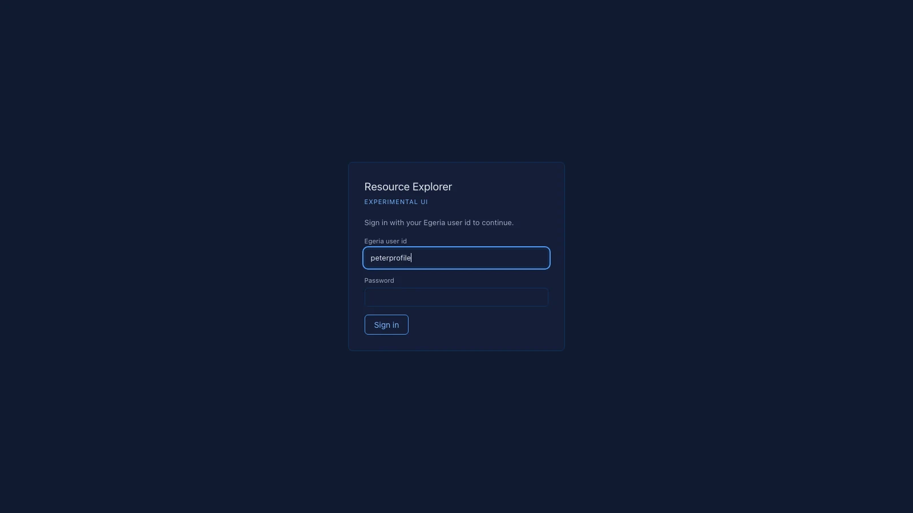

# Part 2 — Sign in and find your way around

The next weekly drop is coming, and Peter needs to get in first. Once you sign in as Peter, the screen shows Peter's
user id at the top right. Everything you do from then on is recorded under it.

**Before you start.** You need the address of your Resource Explorer, and Peter Profile's Quickstart user id and
password. The Getting Started tutorial gives you all three. The usual address is `http://localhost:8810/`. This part
takes about ten minutes, and it changes nothing.

*Screens read on 2026-11-02.*

## Steps

1. **Open the address in a browser.**

   You see a panel headed "Resource Explorer" and "EXPERIMENTAL UI". Under them are the sentence "Sign in with your
   Egeria user id to continue.", an "Egeria user id" box, a "Password" box and a **Sign in** button.

   

   *The sign-in panel. On this Quickstart, the user id box already held "peterprofile".*

   "EXPERIMENTAL UI" means what it says. Resource Explorer is still experimental, and it changes in response to
   what its users ask for (part 1).

   Your Quickstart may fill in the "Egeria user id" box for you. If it does, check that the id is Peter's.

2. **Type Peter's user id and password, then click Sign in.**

   You see the main screen. Peter's user id, "peterprofile", is at the top right, next to **Sign out**.

   There is no separate Resource Explorer account. [Egeria](glossary.md#egeria) checks your password, and Resource
   Explorer does not keep it. Everything you do from now on is recorded in Egeria under your user id.

3. **Find the six areas of the screen.**

   ![Peter's screen, with six numbered areas outlined. 1, the header along the top, with "peterprofile" and "Sign out" at the right. 2, the strip: "Investigation", "1 Scouting" to "6 Curate", "Understanding", "Automate", "Work lists 8", and at the right "RFAs 2" and "Chat". 3, the row "PERSPECTIVE · 0 OF 12" with twelve chips. 4, the left sidebar with "Repos", "DBs", "FS", "Open data" and "Find repos". 5, the main panel, showing the repository amundsen-io/amundsen on its Questions tab. 6, the right-hand rail, "ASK scoped to amundsen".](images/02-sign-in/S03-peters-screen-labelled.webp)

   *Peter's screen. The numbers match the list below.*

   The main panel always shows one [data source](glossary.md#data-source-resource). In the screenshot it is a
   repository, amundsen, that was already there. Yours may show a different one, and your lists in the sidebar may
   be longer or shorter. You add the trial's three sources in part 3.

   1. **The header.** It has the look and three text sizes on the left, then the name of the data source you are
      looking at. At the right are **Activity**, **Admin**, "No investigation", your user id and **Sign out**.
      The screenshots in this tutorial use the look "Dark".
   2. **The strip.** It reads "Investigation · 1 Scouting › 2 Discovery › 3 Assessment › 4 Analysis › 5 Enrichment ›
      6 Curate · Understanding · Automate · ▦ Work lists", with a count after Work lists. At its right end are
      **RFAs**, also with a count, and **Chat**.
      - 1 to 6 are the [stages](glossary.md#stage) a data source goes through, left to right. Part 4 explains them.
      - **Work lists** and **Investigation** come in parts 11 and 12.
      - **Understanding** and **Automate** are for the Advanced tutorial.
      - **RFAs** stands for [requests for action](glossary.md#request-for-action-rfa): things a person must settle.
        Part 7 uses them.
      - **Chat** shows or hides the right-hand rail (area 6).
   3. **The perspectives.** The row "PERSPECTIVE · 0 OF 12" has one chip for each
      [perspective](glossary.md#perspective), from Administration to Steward. Choose one to narrow the questions to those
      that perspective cares about. "0 OF 12" means none is chosen, so you see every question.
   4. **The sidebar.** At the top are **Repos**, **DBs**, **FS** and **Open data**: repositories, databases, file
      systems and open data portals. Under them are a button to add one (here **＋ Find repos**), and a filter box.
      - You can ignore **INVESTIGATION** and **WORK LISTS** until parts 11 and 12.
      - Open data is covered by the Sustainability tutorials, not here.
   5. **The main panel.** It shows the data source you chose, under four tabs: "Questions", "Survey & analyses",
      "By analysis" and "Disposition". Parts 4 to 6 use them.
   6. **The chat rail.** It reads "ASK scoped to" and the data source's name, with a box that says "Ask about this
      resource…", an **Ask** button and **what would answer this?**. Part 8 uses it.

   At the bottom right of every screen is **Feedback**. Use it to say what you need.

4. **Click Activity, read the latest entries, then close it.**

   You see a panel headed "Activity", with "↓ latest first", a box that says "filter by resource or summary…", and
   the buttons **all**, **ok**, **error** and **running**. Under them it says "Showing the most recent 300 entries."

   

   *The Activity panel. Each entry says what ran, on which data source, at which stage, and whether it worked.*

   [Activity](glossary.md#activity) is the log of everything that has run or been published, by anyone using this
   Resource Explorer. Use **error** to see only what failed. Close the panel with **×** at its top right.

## What can go wrong

- **A wrong password.** The panel stays, with a message. Not shown here (gap G22).
- **Egeria is not running.** You cannot sign in, because Egeria is what checks the password. Not shown here (gap
  G22).
- **After about an hour, you are signed out.** A "Signed out" banner appears with a **Sign in** button. Sign in again
  and carry on. Nothing you saved is lost.
- **On the hosted demo, the data is reset every day.** If you stop and come back the next day, the data sources you
  added are gone. Each part says what it needs, so you can add them again. Or do parts 3 to 10 in one sitting.

**Next:** [Part 3 — Add data sources, and find them again](03-add-data-sources.md). Peter registers the
trial's three sources.
