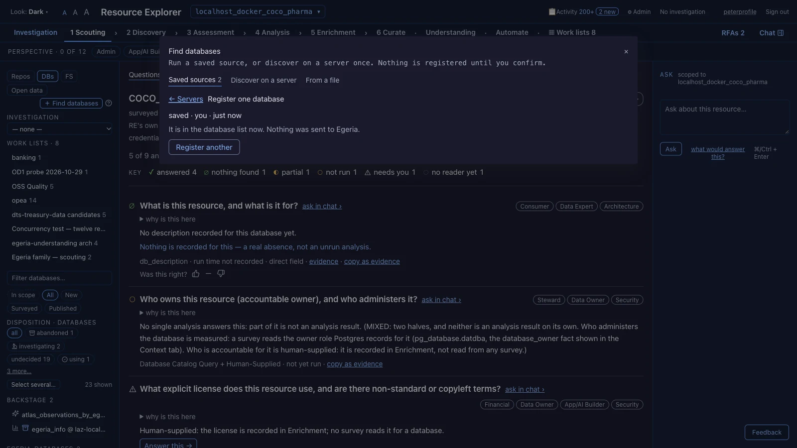

# Part 3 — Add data sources, and find them again

Erin named three sources: the `coco_pharma` database, the `loading_bay` folder, and OpenLineage. Before Resource
Explorer can look at any of them, Peter has to [register](glossary.md#register) each one. Registering tells Resource
Explorer where the source is. It sends nothing to Egeria.

**Before you start.** [Part 2](02-sign-in-and-find-your-way.md): you are signed in as Peter. You also need the
details that the Getting Started tutorial lists:

- the Quickstart database's host, port and name, and a read-only user name and password;
- the `loading_bay` folder's path on this server, and its path inside Egeria's container;
- the OpenLineage repository's GitHub address, `https://github.com/OpenLineage/OpenLineage`.

This part takes about twenty minutes.

*Screens read on 2026-11-02.* The Quickstart in the screenshots already had a `coco_pharma` and a `loading_bay`, so
the screenshots register them as `coco_pharma_trial` and `loading_bay_trial`. Use `coco_pharma` and `loading_bay`
on yours.

## 3a. A database

1. **In the sidebar, click DBs, then ＋ Find databases.**

   A "Find databases" dialog opens: "Run a saved source, or discover on a server once. Nothing is registered until
   you confirm." It has three tabs: "Saved sources", "Discover on a server" and "From a file".

   There are several ways to find databases. This tutorial registers one by hand, which is the simplest. On the
   "Saved sources" tab, click **Register one database…**.

2. **Read the form.** It says: "Test the connection first; Register is available once the test has passed for what is
   typed here. Nothing is sent to Egeria."

3. **Fill in the form.**

   

   *The form filled in, before the password and the test. Your slug is `coco_pharma`.*

   - **SLUG:** `coco_pharma`. A [slug](glossary.md#slug) is a short name with no spaces that Resource Explorer uses
     in addresses. You choose it now, and it cannot have spaces.
   - **DISPLAY NAME:** the name you want to read in lists, such as "coco_pharma".
   - **HOST**, **PORT** and **DATABASE:** from the Getting Started tutorial. In the screenshot they are "localhost",
     "5442" and "coco_pharma".
   - **GROUP:** leave it as "No group". Part 9 explains groups.
   - **USERNAME** and **PASSWORD**, under "CREDENTIAL (stored with the database)": use a read-only account. In the
     screenshot the user name is "surveyor".

   Why read-only? The first stages read only the database's own catalog: tables, columns, keys, comments and row
   estimates. Resource Explorer asks for more only when a later step needs to read rows, and it says which step and
   why. The password is stored encrypted, and it is never shown again.

   Leave "▶ Egeria connection (optional)" closed. You do not need it in this tutorial (gap G7).

4. **Click Test connection.** The line beside the buttons changes from "○ not tested" to the test's result. Its exact
   words are not shown here. **Register** works once the test has passed.

5. **Click Register.**

   

   *"It is in the database list now. Nothing was sent to Egeria."*

   The dialog says "saved · you · just now" and "It is in the database list now. Nothing was sent to Egeria." Close
   the dialog with **×**.

6. **Find the database and open it.** Type its display name into the "Filter databases…" box under **DBs**, and click
   its row.

   

   *A new database: "never surveyed · not published to Egeria".*

   The page reads "never surveyed · not published to Egeria". Nothing has been measured yet, so most questions show
   ○, "not run". Part 5 runs the first survey.

   One question already has an answer. "What is this resource, and what is it for?" shows ∅, because the database's
   description is empty: "No description recorded for this database yet."

**What can go wrong.**

- **The test fails.** You see "Connection failed" or the database's own message, and **Register** stays unavailable.
  Check the host, port, name and user. (Not shown here.)
- **You were signed out in the meantime.** The form says "Sign in to test a connection." Sign in again. (Not shown
  here.)

## 3b. A file system

1. **Click FS, then ＋ Add a file system.**

   An "Add a file system" form opens: "Registering stores it here. Nothing is sent to Egeria."

2. **Fill in SLUG, DISPLAY NAME and MOUNT (LOCAL PATH).**

   - **SLUG:** `loading_bay`.
   - **DISPLAY NAME:** such as "loading_bay".
   - **MOUNT (LOCAL PATH):** where the folder is on the server that runs Resource Explorer. Getting Started lists it.

   When you leave the path box, Resource Explorer checks it. You see "✓ readable here" under the box, or a warning.

3. **Fill in CANONICAL MOUNT: the folder's path inside Egeria's container, `/deployments/loading-bay`.** Getting
   Started lists it.

   Do not leave it blank. The label says "(BLANK = THE MOUNT)", but Egeria sees the folder at a different path from
   this server. With the path Egeria sees, Egeria's own survey can read the folder in part 5 (gap G5).

4. **Leave GROUP as "No group", and click Register.**

   The form closes, and the new file system's page opens. It reads "never surveyed · not published to Egeria".

   Inside `loading_bay` you will also see a `Sustainability Files` folder and NAICS reference data. Those belong to
   Coco Pharmaceuticals' Sustainability project, which has its own tutorials. This tutorial reads the `sample-data`
   hospital folders, where the Drop Foot trial's weekly files arrive.

The screenshot for this step is not shown here: the server path in it names a real person's account (gap G25).

**What can go wrong.**

- **"⚠ this server can't read this path · you can still register"**, or **"⚠ this is a file, not a folder · you
  can still register"**. Registering still works, but no survey can read the folder until the path is right. (Not
  shown here.)
- **"✕ already registered".** That slug is taken. Choose another. (Not shown here.)

## 3c. A repository

1. **Click Repos, then ＋ Find repos.**

   A "Find and import candidate repos" dialog opens: "Search GitHub or load a list — nothing is registered until you
   select rows below". It has two tabs: "🔍 Search GitHub" and "📄 From a list".

2. **Click 📄 From a list, paste the OpenLineage address into the box, and click Load pasted list.**

   

   *OpenLineage, loaded from a list. On this Quickstart it was already registered.*

   The list loads into a table with one row, OpenLineage/OpenLineage. The message above it says "Nothing is registered
   yet — select rows below and Import Selected to add them."

3. **Tick the row, and click Import Selected.**

   In the screenshot, OpenLineage was already registered, so its STATUS reads "✓ registered" and its box cannot be
   ticked. Peter uses the registration that is already there. On your Quickstart, tick the row and click **Import
   Selected**; the repository then appears in the sidebar under **Repos**. What the screen shows while it imports is
   not shown here.

   A new repository reads "not yet surveyed", not zero. Its numbers arrive with its first survey.

## 3d. Finding things again

1. **Use the filter box under Repos, DBs or FS.** It narrows the list as you type.

   

   *"lineage" in the filter box under Repos.*

2. **For repositories, the chips All, New, Surveyed and Published narrow the list.** Leave **In scope** for part
   12.

3. **Leave the PERSPECTIVE chips off for this tutorial.** They narrow the questions to who is asking (part 2).

4. **With FS chosen, click 🔎 Find by passages, and ask about the Drop Foot trial.**

   A "Find a file system by its passages" dialog opens: "Searches the narrative files already read. A passage is a
   proposal, never a fact." Type a question, such as "Drop Foot trial weekly measurements", and click **Search**.

   

   *Your new file system is "not read yet, not searched", not "no match".*

   A passage is what a file says, not something measured, so the screen calls it a proposal, never a fact. Your new
   file system is listed under "not read yet, not searched": nobody has read its narrative files yet, so it was not
   searched. That is not the same as "no match". Part 5 reads the files (**Read narrative files**), and then this
   search can find it.

## What you have now

Three data sources registered in Resource Explorer: a database, a file system and a repository. Each one reads "never
surveyed" or "not yet surveyed". Nothing has been sent to Egeria.

**Next:** [Part 4 — The stages: a funnel from cheap to costly](04-the-stages.md). Peter decides where to spend the
time.
